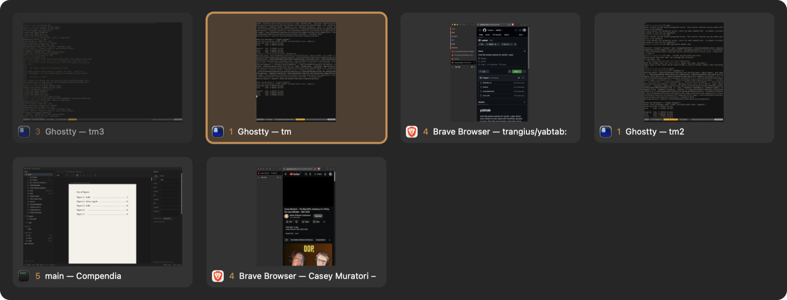

# yabtab

Cmd+Tab window switcher for macOS + yabai. Shows every window on every space with
thumbnails, in most-recently-used order, each labeled with its space number.
Quick Cmd+Tab flips between the last two windows; arrows move in the grid.

Setup:
- Signing cert "WinPick Local Signing" in the login keychain (self-signed, code signing),
  so Screen Recording permission survives rebuilds.
- `./build.sh` builds `~/Applications/YabTab.app` and installs a launch agent that keeps it running.
- yabairc: `yabai -m signal --add label=yabtab_mru event=window_focused action="echo \$YABAI_WINDOW_ID >> /tmp/yabtab-mru"`
- After a rebuild: `pkill -x YabTab` (launchd restarts it).
